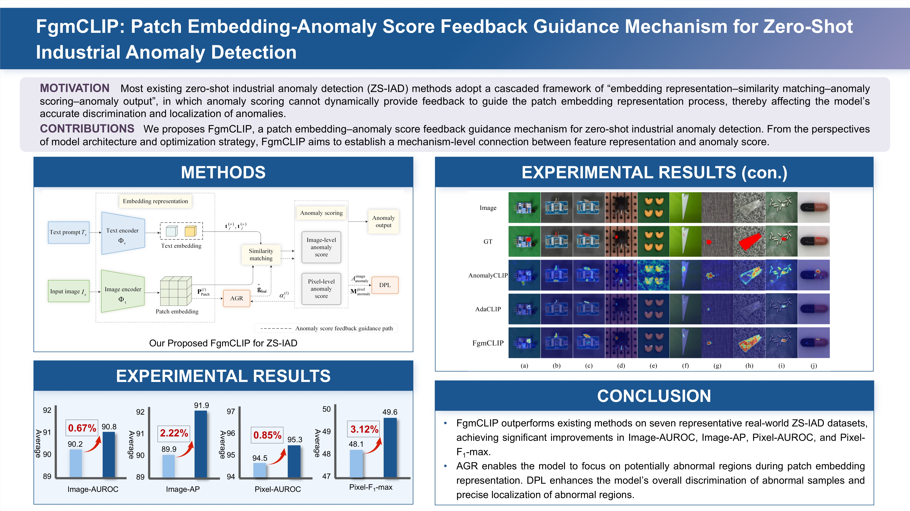

# Patch Embedding-Anomaly Score Feedback Guidance Mechanism for Zero-Shot Industrial Anomaly Detection

## Introduction

  

  <strong>Abstract:</strong> 		Zero-shot industrial anomaly detection aims to detect and localize unknown abnormal regions in target-domain samples by training only on source-domain data. However, most existing methods adopt a cascaded framework of ``embedding representation-similarity matching-anomaly scoring-anomaly output''. In this framework, anomaly scores are not used as feedback to dynamically guide information interaction and semantic aggregation among image patch embeddings. Consequently, anomaly-related information remains insufficiently utilized in constructing image embeddings, causing the models to easily confuse salient responses induced by background variations or local appearance changes with real anomalies in scenarios with complex background variations and low contrast, thereby affecting detection performance.	To this end, this paper proposes a patch embedding-anomaly score feedback guidance mechanism (FgmCLIP). FgmCLIP employs an anomaly score-guided patch embedding representation approach that jointly incorporates correlations among patch embeddings and an anomaly score-guided bias into attention modeling. By combining residual fusion with cluster-level weighted fusion, it performs semantic aggregation of potentially abnormal patch embeddings to construct more discriminative image embeddings. It further develops a dual-path anomaly scoring loss to impose joint constraints on image-level anomaly discrimination and pixel-level anomaly localization, thereby improving anomaly detection performance. Experimental results on seven representative industrial anomaly detection datasets show that FgmCLIP achieves average scores of 90.8, 91.9, 95.3, and 49.6 on Image-AUROC (area under the receiver operating characteristic curve), Image-AP (average precision), Pixel-AUROC, and Pixel-F1-max (maximum F1-score)}, respectively, outperforming state-of-the-art methods by 0.67%, 2.11%, 0.74%, 2.90%, respectively. FgmCLIP also enables accurate detection of diverse anomaly types in complex industrial scenarios.

## Highlights

- **We propose FgmCLIP, a patch embedding–anomaly score feedback guidance mechanism for zero-shot industrial anomaly detection.
- **AGR uses anomaly scores to guide patch interactions and weighted cluster fusion.
- **DPL supervises image-level discrimination and pixel-level localization.
- **FgmCLIP achieves competitive performance on seven industrial anomaly detection datasets, including MVTec-AD, VisA, MPDD, BTAD, SDD, DAGM, and DTD-Synthetic.

## Overview of FgmCLIP

## Main Results

All values are expressed as percentages (%); ↑ indicates that higher is better. Bold values indicate the best reported results in each row. 

### Table 1. Image-AUROC ↑

| Dataset | WinCLIP [24] | APRIL-GAN [28] | AnomalyCLIP [25] | AdaCLIP [26] | AnoCLIP [27] | RDMD [48] | GenCLIP [47] | DACLIP [49] | FgmCLIP (Ours) |
|:--|:--:|:--:|:--:|:--:|:--:|:--:|:--:|:--:|:--:|
| MVTec-AD [54] | 91.8† ± 0.0 | 86.0 ± 0.2 | 91.6 ± 0.3 | 89.3 ± 0.3 | **92.5† ± 0.0** | 86.9† | 90.9† | 90.7† | 91.6 ± 0.2 |
| VisA [55] | 78.1† ± 0.0 | 78.0 ± 0.3 | 82.0 ± 0.4 | 86.0 ± 0.3 | 79.2† ± 0.0 | 84.4† | 83.3† | 85.2† | **87.1 ± 0.1** |
| MPDD [56] | 63.6 ± 0.0 | 72.8 ± 0.3 | 77.1 ± 0.2 | 76.1 ± 0.4 | 72.7 ± 0.0 | 75.5† | 73.7† | **80.1†** | 74.3 ± 0.4 |
| BTAD [57] | 68.2 ± 0.0 | 73.6 ± 0.2 | 88.2 ± 0.3 | 88.5 ± 0.3 | 80.3 ± 0.0 | 88.8† | 90.0† | 90.5† | **90.6 ± 0.2** |
| SDD [58] | 84.3 ± 0.0 | 79.9 ± 0.2 | 84.7 ± 0.2 | 97.1 ± 0.2 | 94.4 ± 0.0 | **97.4†** | 92.2† | 96.0† | 96.5 ± 0.1 |
| DAGM [59] | 91.8 ± 0.0 | 94.4 ± 0.1 | 97.7 ± 0.2 | **99.2 ± 0.1** | 89.7 ± 0.0 | — | — | 95.5† | 98.4 ± 0.3 |
| DTD-Synthetic [60] | 93.2 ± 0.0 | 86.5 ± 0.3 | 93.4 ± 0.3 | 95.5 ± 0.2 | 94.9 ± 0.0 | — | 88.8† | 93.1† | **97.4 ± 0.3** |
| **Average** | 81.6 ± 0.0 | 81.6 ± 0.2 | 87.8 ± 0.3 | 90.2 ± 0.3 | 86.2 ± 0.0 | — | — | 90.2† | **90.8 ± 0.2** |

### Table 2. Image-AP ↑

| Dataset | WinCLIP [24] | APRIL-GAN [28] | AnomalyCLIP [25] | AdaCLIP [26] | AnoCLIP [27] | RDMD [48] | GenCLIP [47] | DACLIP [49] | FgmCLIP (Ours) |
|:--|:--:|:--:|:--:|:--:|:--:|:--:|:--:|:--:|:--:|
| MVTec-AD [54] | **96.5 ± 0.0** | 93.6 ± 0.2 | 96.2 ± 0.2 | 94.4 ± 0.2 | 95.1 ± 0.0 | 93.7† | 96.1† | 95.8† | 96.1 ± 0.1 |
| VisA [55] | 81.2 ± 0.0 | 81.3 ± 0.3 | 85.4 ± 0.2 | 86.5 ± 0.4 | 80.2 ± 0.0 | 86.2† | 87.5† | 87.8† | **89.2 ± 0.1** |
| MPDD [56] | 69.9 ± 0.0 | 80.4 ± 0.3 | 81.8 ± 0.3 | 76.9 ± 0.5 | **83.6 ± 0.0** | 77.0† | 79.6† | 82.8† | 79.8 ± 0.5 |
| BTAD [57] | 70.9 ± 0.0 | 68.5 ± 0.3 | 87.3 ± 0.1 | 93.7 ± 0.2 | 72.8 ± 0.0 | 88.8† | **96.9†** | 82.0† | 95.6 ± 0.2 |
| SDD [58] | 77.4 ± 0.0 | 71.6 ± 0.4 | 80.0 ± 0.1 | 90.4 ± 0.3 | 90.8 ± 0.0 | **93.5†** | 68.9† | 89.5† | 90.4 ± 0.2 |
| DAGM [59] | 79.5 ± 0.0 | 83.8 ± 0.2 | 92.4 ± 0.3 | 89.7 ± 0.3 | 76.1 ± 0.0 | — | — | **95.1†** | 93.7 ± 0.3 |
| DTD-Synthetic [60] | 92.6 ± 0.0 | 95.1 ± 0.3 | 96.9 ± 0.3 | 98.0 ± 0.4 | 93.3 ± 0.0 | — | 96.3† | 97.0† | **98.6 ± 0.3** |
| **Average** | 81.1 ± 0.0 | 82.0 ± 0.3 | 88.6 ± 0.2 | 89.9 ± 0.3 | 84.6 ± 0.0 | — | — | 90.0† | **91.9 ± 0.2** |

### Table 3. Pixel-AUROC ↑

| Dataset | WinCLIP [24] | APRIL-GAN [28] | AnomalyCLIP [25] | AdaCLIP [26] | AnoCLIP [27] | RDMD [48] | GenCLIP [47] | DACLIP [49] | FgmCLIP (Ours) |
|:--|:--:|:--:|:--:|:--:|:--:|:--:|:--:|:--:|:--:|
| MVTec-AD [54] | 85.1† ± 0.0 | 87.5 ± 0.3 | 91.1 ± 0.4 | 88.6 ± 0.3 | 86.6† ± 0.0 | 88.0† | **92.7†** | 88.0† | 90.2 ± 0.1 |
| VisA [55] | 79.6† ± 0.0 | 94.2 ± 0.2 | 95.4 ± 0.3 | 95.5 ± 0.3 | 85.9† ± 0.0 | 94.9† | 95.3† | 95.6† | **95.9 ± 0.2** |
| MPDD [56] | 76.4 ± 0.0 | 94.1 ± 0.4 | 96.5 ± 0.2 | 96.1 ± 0.3 | 62.3 ± 0.0 | **96.8†** | 96.2† | 96.4† | 96.4 ± 0.3 |
| BTAD [57] | 72.7 ± 0.0 | 60.9 ± 0.3 | **94.1 ± 0.3** | 92.2 ± 0.2 | 75.2 ± 0.0 | 90.7† | 93.6† | 92.2† | 92.9 ± 0.3 |
| SDD [58] | 68.8 ± 0.0 | 79.7 ± 0.2 | 90.7 ± 0.2 | **97.8 ± 0.3** | 97.1 ± 0.0 | 97.1† | 96.8† | 97.1† | **97.8 ± 0.1** |
| DAGM [59] | 87.6 ± 0.0 | 82.5 ± 0.3 | **95.6 ± 0.3** | 91.5 ± 0.4 | 79.7 ± 0.0 | — | — | 94.3† | 94.9 ± 0.2 |
| DTD-Synthetic [60] | 83.9 ± 0.0 | 95.4 ± 0.2 | 97.9 ± 0.2 | 97.7 ± 0.3 | 97.7 ± 0.0 | — | 97.9† | 98.6† | **98.9 ± 0.2** |
| **Average** | 79.2 ± 0.0 | 84.9 ± 0.3 | 94.5 ± 0.3 | 94.2 ± 0.3 | 83.5 ± 0.0 | — | — | 94.6† | **95.3 ± 0.1** |
### Table 4. Pixel-F1-max ↑

| Dataset | WinCLIP [24] | APRIL-GAN [28] | AnomalyCLIP [25] | AdaCLIP [26] | AnoCLIP [27] | RDMD [48] | GenCLIP [47] | DACLIP [49] | FgmCLIP (Ours) |
|:--|:--:|:--:|:--:|:--:|:--:|:--:|:--:|:--:|:--:|
| MVTec-AD [54] | 31.7† ± 0.0 | 43.5 ± 0.3 | 37.8 ± 0.2 | **43.6 ± 0.1** | 30.1† ± 0.0 | — | — | 42.2† | 43.5 ± 0.1 |
| VisA [55] | 14.8† ± 0.0 | 32.3 ± 0.2 | 25.6 ± 0.3 | **37.9 ± 0.2** | 14.7† ± 0.0 | — | — | 32.3† | 37.1 ± 0.1 |
| MPDD [56] | 15.4 ± 0.0 | 30.7 ± 0.4 | 28.6 ± 0.4 | 30.1 ± 0.2 | 15.6 ± 0.0 | — | — | 30.9† | **33.4 ± 0.4** |
| BTAD [57] | 18.5 ± 0.0 | 37.3 ± 0.2 | 34.2 ± 0.2 | 47.5 ± 0.4 | 23.4 ± 0.0 | — | — | **47.9†** | 47.8 ± 0.4 |
| SDD [58] | 21.3 ± 0.0 | **56.0 ± 0.3** | 35.6 ± 0.3 | 50.1 ± 0.1 | 23.1 ± 0.0 | — | — | 48.2† | 48.7 ± 0.2 |
| DAGM [59] | 13.9 ± 0.0 | 58.0 ± 0.1 | 53.7 ± 0.2 | 55.3 ± 0.1 | 12.8 ± 0.0 | — | — | 62.6† | **62.9 ± 0.4** |
| DTD-Synthetic [60] | 16.1 ± 0.0 | 72.8 ± 0.2 | 67.8 ± 0.2 | 72.6 ± 0.3 | 46.8 ± 0.0 | — | — | 72.6† | **73.6 ± 0.4** |
| **Average** | 18.8 ± 0.0 | 47.2 ± 0.3 | 40.5 ± 0.3 | 48.2 ± 0.2 | 23.8 ± 0.0 | — | — | 48.1† | **49.6 ± 0.3** |

**Notes:** “†” marks results taken directly from the original papers. “—” indicates that the corresponding result was not reported and the method’s source code is not publicly available. Other results are from our reproduction experiments, reported as mean ± standard deviation over five independent runs with seeds 111-115. 

## Experimental Setup

### 1. Cross-Dataset Zero-Shot Protocol

In each experiment, the model is trained on a single source-domain dataset and evaluated on an independent target-domain dataset. Target-domain samples are not used for training.

| Source Dataset | Target Datasets |
|:--|:--|
| MVTec-AD | VisA, MPDD, BTAD, SDD, DAGM, DTD-Synthetic |
| VisA | MVTec-AD |

### 2. Datasets and Data Preparation

FgmCLIP is evaluated on seven industrial anomaly detection benchmarks. The dataset packages used by this project are available below:

| Dataset | Domain | Description | Download |
|:--|:--|:--|:--|
| MVTec-AD | Industrial | Object and texture anomaly detection benchmark with image-level labels and pixel-level masks. | [Google Drive](https://drive.google.com/drive/folders/126ZyuMsgrmwJd_7hlNJQitv_liXfRzJt?usp=sharing) |
| VisA | Industrial | Visual anomaly benchmark for industrial object inspection across multiple product categories. | [Google Drive](https://drive.google.com/drive/folders/1cgpyk8Gfpl_GVnA_l-K8tOV67mKOZdZj?usp=sharing) |
| MPDD | Industrial | Metal parts defect detection benchmark with image-level labels and pixel-level defect annotations. | [Official Repository](https://github.com/stepanje/MPDD) |
| BTAD | Industrial | BTech industrial anomaly detection benchmark with three product categories. | [Google Drive](https://drive.google.com/drive/folders/1GW9kXgxJM0kC2TX3vWuydaiRkcdg7gjG?usp=sharing) |
| SDD | Industrial | Surface defect detection benchmark with image-level labels and pixel-level annotations for defects on electrical commutators. | [Official Website](https://www.vicos.si/resources/kolektorsdd/) |
| DAGM | Industrial | Synthetic textured-surface defect benchmark with annotated defects. | [Google Drive](https://drive.google.com/drive/folders/1gkjep91EdTgDlEuEVfK-iKVr2mzJi81G?usp=sharing) |
| DTD-Synthetic | Industrial | Synthetic anomaly localization benchmark built from texture images. | [Google Drive](https://drive.google.com/drive/folders/1VZIx-k5a6llIlTi2_lNTSJs3zzyelBlV?usp=sharing) |

We adopt the same dataset structure and JSON format as [AnomalyCLIP](https://github.com/zqhang/AnomalyCLIP). After downloading a dataset, place it under your local dataset directory and make sure `meta.json` exists in the dataset root. We also provide scripts to generate the required JSON metadata files:

### 2. Backbone and Training Configuration

| Item | Setting |
|:--|:--|
| Backbone | Pretrained CLIP ViT-L/14@336px |
| Input resolution | 518 × 518 pixels |
| Selected visual feature layers | 6, 12, 18, 24 |
| Prompt depth | 4 |
| Prompt length | 6 |
| Top-k patches | 100 |
| Number of clusters | 20 |
| Guidance strength | 0.8 |
| Optimizer | AdamW |
| Learning rate | 0.01 |
| Training epochs | 8 |
| Framework | PyTorch 2.3.1 with CUDA 12.1 |
| GPU | NVIDIA RTX 3090, 24 GB |

The backbone name identifies the pretrained CLIP variant; the input resolution used in this study is 518 × 518 pixels.

## News

- The paper is currently under review. The code will be made available upon acceptance.

## Acknowledgements

We thank the authors of [CLIP](https://github.com/openai/CLIP), [AnomalyCLIP](https://github.com/zqhang/AnomalyCLIP), and [AdaCLIP](https://github.com/caoyunkang/AdaCLIP) for making their implementations publicly available.
